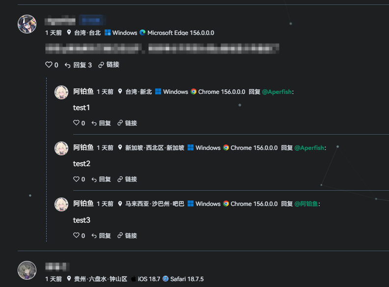
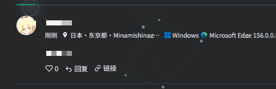
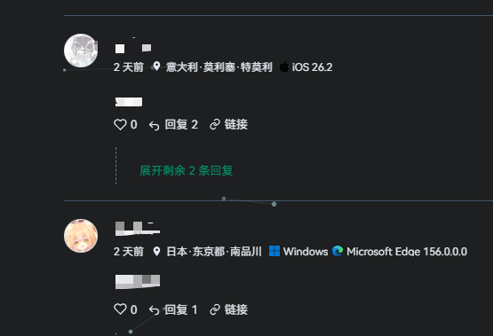

> **使用警告：禁止服务器位于国内的网站使用本插件，否则后果自负。**
>
> **根据《互联网用户账号信息管理规定》第十二条，要求在账号信息页展示“合理范围内”的 IP 属地**
>
> **[互联网用户账号信息管理规定_中央网络安全和信息化委员会办公室](https://www.cac.gov.cn/2022-06/26/c_1657868775042841.htm)**
>
> 以上为维护者使用提醒，不改变 GPL-3.0 许可证。README 提醒不等于免责保证；插件不会自动检测服务器所在地或阻止安装运行。

# 评论组件Next IP属地扩展

为 Halo「评论组件 Next」提供独立的 IP 属地增强功能。本项目为第三方实验性扩展，非原作者官方发布，不修改原插件 JAR 文件。

## 环境要求

- 扩展版本：**1.0.13-4**。
- Halo >= 2.27.0，Java >= 21。
- 前置：原作者未修改的评论组件 Next **1.0.13**，插件 ID 为 `PluginCommentNext`。
- 扩展使用原版内部字段接入，仅适配指定版本，升级前置前需重新确认兼容性。

## 功能

- 国内外 API URL 模板独立配置，本地 IPv4/IPv6 数据库分流。
- CN 使用国内模板，HK/MO/TW 及其他已知地区使用国外模板；未知归属不请求国外接口。
- 普通省市同名保留，例如吉林·吉林；台湾优先显示城市，香港首段简称香港。
- 国外按国家·省份（州）·城市排列，支持部分本地中文译名和可选备用翻译。
- 缓存、并发合并、在线失败离线回退。

**区县默认关闭，开关同时作用于普通城市和直辖市。按需开启**。

仅影响国内IP定位，国外IP仍然是国家·省份（州）·城市排列

| 示例 | 区县关闭（默认） | 区县开启 |
|---|---|---|
| 广东省深圳市南山区 | 广东·深圳 | 广东·深圳·南山区 |
| 吉林省吉林市船营区 | 吉林·吉林 | 吉林·吉林·船营区 |
| 北京市海淀区 | 北京 | 北京·海淀区 |

区县依赖接口实际数据；缺失或离线回退时不推测。开启开关不代表每个 IP 都能准确到区县。

*区县级开启时：*

## 安装与设置

1. 先安装原版评论组件 Next 1.0.13，确认评论列表正常。
2. 安装并启用本扩展，不与此前直接修改过的评论 JAR 混用。
3. 原评论插件的“显示评论 IP 属地”开关保持开启。
4. 在扩展“设置 → IP 属地”配置接口。国内默认百度地图，需要自己的服务端 AK；国外默认 ip-api 中文接口。
5. “国内 IP 显示区县（含直辖市）”默认关闭。升级会保留已有配置，曾开启旧版区县开关的用户请手动关闭。

关闭扩展自身“显示评论 IP 属地”会委托原版解析，并不完全关闭公开属地。如需完全关闭，请关闭原评论插件的 IP 属地开关。

## 可选备用翻译

填写完整 HTTPS Chat Completions 请求地址、模型 ID 和 API Key 即可配置。地址或模型留空关闭，默认不启用外部翻译。

仅发送地名，不发送访客 IP、经纬度、评论或身份信息。成功缓存 7 天，失败缓存 1 分钟；超时或格式异常保留原名。机器翻译不保证所有地名正确。

*无翻译服务：*

*有翻译服务（使用glm-4-flash）：*

## 数据与隐私

在线定位会把待解析 IP 发送给管理员配置的定位服务商，请自行确认数据处理方式、必要性与授权。密钥不作为前台配置下发，请勿提交到仓库、Issue 或截图。

默认关闭区县只减少展示精度，不能替代其他个人信息保护义务。

## 验证范围

本版通过 31 项区县断言和 19 项原格式回归，共 50 项断言，包含四直辖市开关、同名省市、台湾/香港、缺失区县和缓存隔离。另有基础字节码及接口连接检查。

尚未完成真实 Halo 容器的安装启停、评论请求和在线 API 验收。接口签名夹具不随插件打包，其检查不能替代实机测试。请先在测试站点验证。

## 问题反馈

请提供 Halo、Java、主插件和扩展版本、复现步骤，以及请求状态码或异常堆栈。提交前删除 IP、密钥和个人信息。

## 致谢与许可

本项目依赖并复用 [评论组件 Next](https://github.com/acanyo/plugin-comment-next) 的部分代码，感谢原作者。

相关代码适用 GPL-3.0，第三方组件及数据库保留各自许可。上述使用警告不作为 GPL 授权之外的附加地域限制。

使用codex编写，内容可能有偏差

